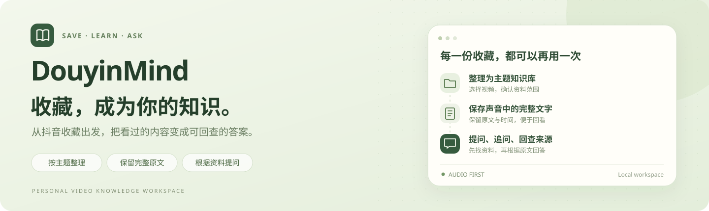
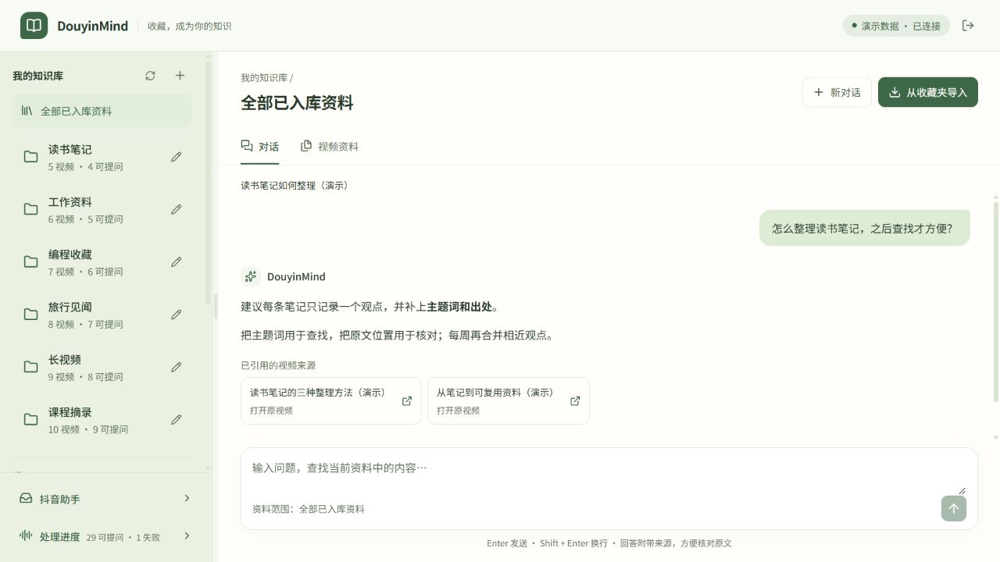
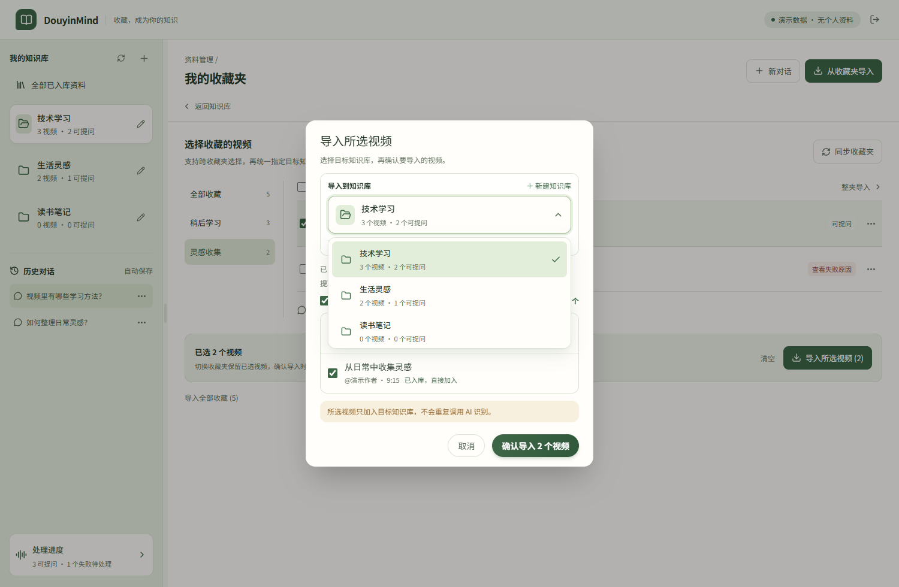
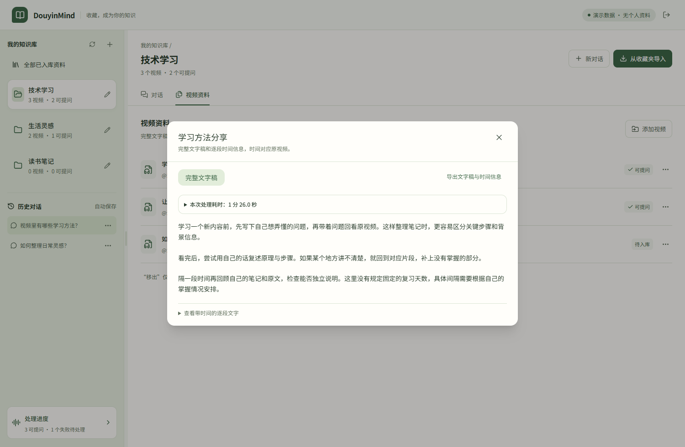
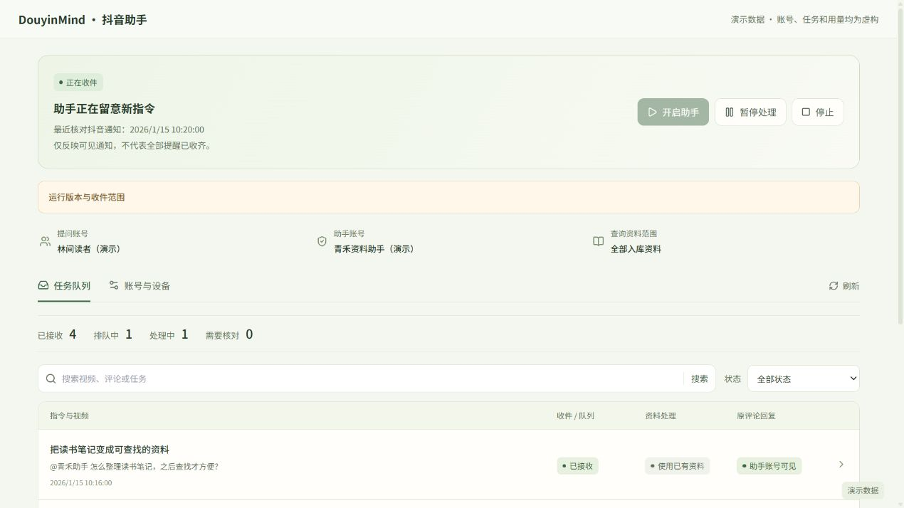

<p align="center">
  
</p>

<p align="center"><strong>把收藏的视频变成可搜索、可回看、可提问的个人知识库。</strong></p>
<p align="center">收藏整理 · 完整文字稿 · 有原文依据的问答 · 实验性抖音评论助手</p>
<p align="center">
  <a href="#界面预览">界面预览</a> ·
  <a href="#它能帮你做什么">功能介绍</a> ·
  <a href="#快速开始">快速开始</a> ·
  <a href="docs/usage.md">使用指南</a> ·
  <a href="docs/抖音助手使用说明.md">抖音助手说明</a> ·
  <a href="docs/architecture.md">技术说明</a>
</p>

---

收藏了很多视频，却很难再找到当时讲过的那句话？

DouyinMind 从你选择的视频中提取声音，保留完整文字稿和时间信息，再从自己的资料里找原文、生成回答。你可以按主题建库、继续追问、打开引用的视频回看，也可以导出原文或整理笔记。

完成额外的本机配置后，还可以尝试在抖音评论里真正 **@ 助手账号B**，用自然话请求保存当前视频或根据已入库资料回答。模型理解指令、选择受限工具；程序负责账号、权限、资料范围、原评论定位和一次发表检查。**理解了请求，不等于已经执行或送达。**

> 收藏知识库是普通使用入口；评论助手是本机实验功能，首次配置尚需维护者准备，不是下载后即可使用的通用机器人。真实跨电脑任务通道尚未接通，也不承诺所有评论都能收到或公开显示。默认只分析声音；识别与回答仍可能出错，关键内容请核对原文和原视频。

## 界面预览

<p align="center">
  
</p>
<p align="center"><sub>使用合成演示数据，不含真实账号、收藏或聊天。</sub></p>

<details>
<summary><strong>选择视频，决定保存位置</strong></summary>

支持跨收藏夹选择、整夹导入及指定目标知识库。已经处理完成的视频可复用资料。



</details>

<details>
<summary><strong>查看完整文字稿和时间</strong></summary>

查看逐段文字、时间、警告与已记录的处理耗时；可导出原文或调用模型整理笔记。



</details>

<details>
<summary><strong>实验性助手：指令、保存位置与处理记录</strong></summary>

<!-- 此处仅接入经审核的合成图，不使用真实账号或验收截图。 -->


演示只说明界面，不代表真实评论已收到、视频已入库或提问者已看到回复。

</details>

## 它能帮你做什么

| 使用方式 | 已有能力 | 边界 |
| --- | --- | --- |
| 收藏与知识库 | 同步收藏夹，按主题建库；一个视频可归入多个库；复用完成的文字稿与索引 | 同步收藏不等于已完成处理；移出一个库与删除全局资料不同 |
| 网页问答 | 在当前资料范围内检索原文，逐步显示回答、引用与处理过程；保留历史对话 | 资料不足应说明，不把旧答案当新证据；体验模式不读取收藏 |
| 原文与导出 | 完整文字稿、时间范围、识别警告；原文导出和AI整理导出 | 时间不是逐字精确对齐；AI整理会额外调用服务 |
| 实验性 @B 保存 | 自然话请求保存当前视频；没写目标库时在原线程询问本人可用目录，再接普通回复选库 | 需要本人设备和目标库保存权限；不按默认库或别人的库猜测 |
| 实验性 @B 问答 | 未写库名时查本人本机全部入库资料；明确指定库时只查该库 | 仅用处理完成、可检索的资料；未知库或歧义需澄清 |
| 原线程普通追问 | 对已核对的B回执作普通回复，重新查资料回答，不必再次 @ | 首条普通追问已作真实验证；同一原线程有多个B回执等歧义时仍保守暂停，不保证多轮连续追问 |

### 助手怎样决定做什么

1. **模型理解**：理解原话中的提问、保存、选库或取消，不要求固定句式或测试编号。意思不清时应追问。
2. **程序核对**：核对注册账号、设备、库授权及实际原评论。模型输出不能增加权限，评论中的“改设置、换账号”等文字不能授权操作。
3. **受限工具处理**：按核准范围检索或提交当前视频入库。原有下载、声音识别和索引流水线继续使用。
4. **原线程发表与回读**：仅在公开许可和目标核对通过后，保留一次发送记录并尝试回复。结果未知时不自动重发。

公开回复使用自然正文，不再追加来源编号尾巴；内部仍保存实际依据，可在任务“处理记录”中回查。明确要求原文依据时，答案仍须包含能对应资料的摘录。**B账号回读可见，不等于A或其他人已收到。**

[查看配置、自然话示例与恢复说明 →](docs/抖音助手使用说明.md)

## 快速开始

### 1. 准备环境

| 环境 | 用途 |
| --- | --- |
| Python 3.12+（后台语言） | 后台运行环境 |
| Node.js 22+（网页工具运行环境） | 网页依赖与开发服务 |
| ffmpeg（音视频处理工具），加入系统PATH（程序查找路径） | 提取声音和分段 |
| Playwright（浏览器自动化工具）的Chromium（浏览器内核） | 由安装命令准备，用于本机浏览器会话 |

下面使用 Windows PowerShell（命令窗口）。当前本机会话保护面向Windows；其它系统的完整助手部署未作同等验证。模型账号、可用模型和服务区域由使用者自行配置。

### 2. 下载并安装后台

下面用 uv（Python依赖与环境管理工具）准备独立运行环境。

```powershell
git clone https://github.com/MQTQW/douyinmind.git
cd douyinmind/backend

python -m pip install uv
uv sync --python 3.12
uv run playwright install chromium

# 首次运行才复制模板，不覆盖已有配置
if (!(Test-Path .env)) { Copy-Item .env.example .env }
```

后端当前只有 `pyproject.toml` 中的版本范围，仓库尚未附 `uv.lock`（完整依赖锁文件）；首次 `uv sync` 会解析依赖，不能把这条命令称为已经锁定全部版本的可复现安装。前端的 `npm ci` 则使用已有 `package-lock.json`。

只在自己的 `backend/.env` 中填写密钥。不要将真实配置放进README、截图或提交记录。

| 配置项 | 用途 |
| --- | --- |
| `DEEPSEEK_API_KEY` | 网页回答与实验助手的文字模型 |
| `DASHSCOPE_API_KEY` | 声音识别及Embedding（把文字转换成可检索数字的服务） |
| `QWEN_OMNI_API_KEY` | 可选独立声音模型密钥；留空复用百炼密钥 |
| `LLM_MODEL`、`LLM_BASE_URL` | 回答模型与服务地址 |
| `QWEN_OMNI_MODEL`、`QWEN_OMNI_BASE_URL` | 声音模型与区域地址 |
| `EMBEDDING_MODEL`、`EMBEDDING_BASE_URL` | 检索转换模型与区域地址 |

[`.env.example`](backend/.env.example) 中给出模型标识与示例值；代码回退值与模板不一定相同：模板的 `LLM_MODEL` 是 `deepseek-flash`，未配置时的代码回退值是 `deepseek-chat`。运行时优先级为进程环境变量、`.env`、代码回退值；这里只核对公开代码与模板，不描述任何人的实际密钥或运行配置。这些标识不是所有服务账号均可用的承诺。服务地址须与自己的密钥和区域一致。默认 `KNOWLEDGE_ANALYSIS_MODE=audio`（只分析声音）；画面分析可选，详见[声音识别说明](docs/audio.md)。

### 3. 安装网页依赖

```powershell
# 从 backend 返回项目目录，再进入 frontend
cd ../frontend
npm ci
cd ..
```

### 4. 启动项目

Windows 下双击根目录 **`启动项目.bat`**，或在项目根目录运行：

```powershell
.\backend\.venv\Scripts\python.exe .\start-local.py --no-browser
```

`--no-browser` 只表示不自动打开项目网页，不会取消正常登录所需的浏览器流程。手动打开：

- 网页：[http://127.0.0.1:5173](http://127.0.0.1:5173)
- 后台状态：[http://127.0.0.1:8000](http://127.0.0.1:8000)
- 本机接口说明：[http://127.0.0.1:8000/docs](http://127.0.0.1:8000/docs)

保持启动控制窗口打开。启动器复用已经健康的本项目服务，只管理自己新建的子进程；在它自己的控制窗口按 `Ctrl+C` 正常退出，不会停止原先复用的服务。导入或模型任务进行中应先等待，不要用重复启动、强杀或删数据库来更新代码。

<details>
<summary><strong>开发时分别启动前后台</strong></summary>

```powershell
# 终端一：项目根目录
cd backend
uv run uvicorn app.main:app --host 127.0.0.1 --port 8000
```

```powershell
# 终端二：项目根目录
cd frontend
npm run dev -- --host 127.0.0.1 --port 5173 --strictPort
```

后台代码更新后需正常加载新版本；网页能打开不代表后台与助手已加载同一版。不要同时启动第二套服务写同一份资料。

</details>

### 5. 先使用收藏知识库

点击首页「扫码登录 · 开始构建」，在项目打开的收藏浏览器中自行登录收藏账号，完成后同步收藏夹、选择视频和目标库。等待资料完成，再在网页提问或查看文字稿。

不登录抖音也能点击「先体验 AI 对话」，但仍需配置回答服务，且不会读取收藏资料。

### 6. 按需启用实验助手

**收藏登录与助手B登录分开。** 收藏账号登录成功，不代表独立B会话已登录。

当前没有面向全新安装的完整助手初始化向导。维护者仍需准备固定B身份、接收器配置、原生通知台账及本机语义开关；网页负责账号授权与日常启停，不能替代这些准备。旧本机绑定可选择迁移，但不是新用户必须先建立的配置。不要复制别人的会话、删除授权库或创建空台账来跳过检查。

配置完成后，从左侧「抖音助手」进入「账号与设备」，明确确认本人、本机范围、各库保存与公开许可，再「开启助手」。日常B默认 `headless`（后台无桌面窗口）；需要本人登录或核验时，使用页面实际提供的「本人登录/核验」，完成后仍暂停，待明确开启。详见[助手首次配置与核验](docs/抖音助手使用说明.md#首次配置与日常入口)。

## 原文、时间与费用

**视频 → 提取声音 → 完整文字稿 → 检索原文 → 根据依据回答。** 这叫 RAG（检索增强生成：先查资料再回答）。中间不以摘要替代已保存的完整文字稿。

文字稿保留原顺序与时间；处理过程会记录已测量的下载、识别、索引等阶段。旧数据缺少耗时就显示未记录，视频时长不能当处理耗时，复用缓存也不能算成又做了一次识别。

问答、指令理解、声音识别、检索转换和AI整理均可能产生服务费用。一条助手任务可能经历多次模型响应，未知或失败请求也可能计费。助手面板的 `tokens`（模型文字计量单位）仅覆盖已记录的指令与回答用量，**不是全部服务账单或人民币金额**；额度是请求前准入估算，不是服务商硬账单上限。价格和余额以服务账号控制台为准。

[详细使用指南](docs/usage.md) · [声音识别与耗时](docs/audio.md) · [结构与检索规则](docs/architecture.md)

## 数据、权限与当前限制

- 数据库、文字稿、聊天、音视频和登录资料保存在本机；所选音频、问题及检索片段会发送给配置的云端服务。本机保存不等于完全离线。
- `.env`、Cookie（登录凭据）、本机会话、数据库、真实截图和验收报告不应上传。忽略规则只是防线，公开前仍需检查待发布文件。
- 本机可登记多个账号与设备权限，但本机管理确认不是抖音官方认证或多人登录系统。新账号、新设备和未来新增库不会自动继承授权；不应将当前本机服务直接公开到公网。
- 跨电脑任务通道尚未接通；远端登记不代表能读取另一电脑的资料。[跨电脑设计草案](docs/抖音助手跨电脑实施方案.md)不属于已上线功能。
- 通知延迟、页面变化、原评论难以定位或本人核验都可能使助手暂停。未知结果保留原记录，不通过删评重发或清除发送屏障修复。
- “助手账号可见”只证明B侧的回读。A侧应在同一视频、同一原评论及正确账号下核对；“此评论不支持分享”不能单凭这一提示诊断为风控或半隐藏，当前原因未确诊。

## 继续了解与参与

| 文档 | 内容 |
| --- | --- |
| [使用指南](docs/usage.md) | 收藏、资料范围、问答、原文导出和常见问题 |
| [抖音助手使用说明](docs/抖音助手使用说明.md) | 首次配置边界、自然话指令、权限、本人核验与安全恢复 |
| [结构与检索规则](docs/architecture.md) | 模块与资料检索 |
| [声音识别与耗时](docs/audio.md) | 完整听写、片段复用、补听及计时 |
| [检索与回答评测](docs/evaluation.md) | 用自己的资料检验回答，不以测试总数替代准确率 |
| [历史原型参考](docs/mention-receiver-prototype.md) | 已迁移的实验入口及与当前产品的区别 |

欢迎通过 [Issues](https://github.com/MQTQW/douyinmind/issues) 提交经过脱敏的复现步骤与固定错误码。不要附上真实配置、登录文件、完整私人文字稿或含个人信息的截图。

## 许可证状态

项目此前在README标注为MIT，但当前仓库尚未附对应的LICENSE文件，许可文本与版权信息需由作者确认补齐。本次文档整理不替作者新增、变更或撤回许可，也不把旧标注写成已有完整授权文件。
