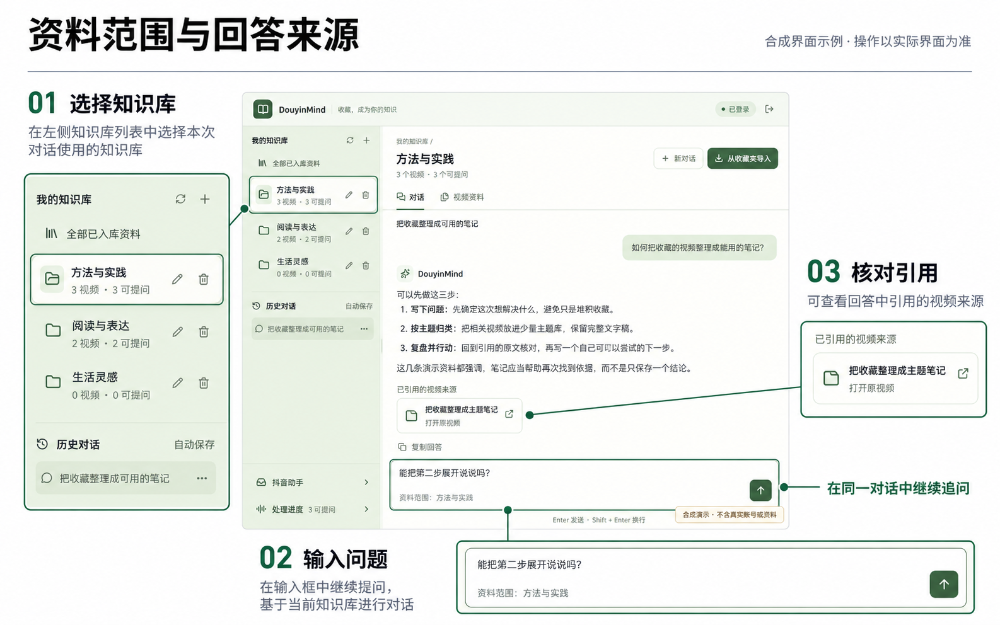
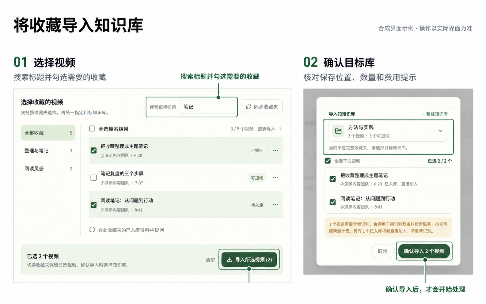

# DouyinMind

**把抖音收藏整理成可搜索、可回看、可提问的个人知识库。**

[使用指南](docs/usage.md) · [实验性抖音助手](docs/抖音助手使用说明.md) · [技术结构](docs/architecture.md) · [声音识别](docs/audio.md)

DouyinMind 在本机管理你选择的视频：提取声音、保存完整文字稿与时间信息，再从这些资料中检索原文、生成回答。它适合整理学习资料、查找收藏中的细节，以及围绕同一主题持续提问。

网页知识库是主要使用入口。项目还包含一个需要额外配置的实验性评论助手，可在抖音原线程接收保存或提问请求；两种入口的准备条件与使用边界不同。



*合成界面示意：确认资料范围，提问后核对回答与引用；按钮以实际界面为准。*

## 目前可以做什么

| 能力 | 当前支持 |
| --- | --- |
| 收藏整理 | 同步收藏夹，按视频标题搜索；跨收藏夹勾选、整夹导入，并确认目标知识库 |
| 完整文字稿 | 默认分析视频声音，保存原顺序、逐段时间与识别警告；已完成资料再次归类时可复用 |
| 资料问答 | 在当前知识库或全部已入库资料中提问，逐步显示回答与引用；保留历史对话并继续追问 |
| 原文与导出 | 查看完整文字稿，导出原文和时间；也可调用模型整理成笔记后导出 |
| 资料与知识库管理 | 批量移出当前库、删除视频全局资料，或逐个删除知识库；操作前分别确认范围 |

**移出当前库、删除知识库、删除视频资料是三种不同操作。** 前两种保留视频原文；删除全局入库资料会影响所有知识库。批量操作遇到首个失败或不确定结果会停止后续项，已经成功的项不会自动回滚。[查看管理说明](docs/usage.md#知识库范围与删除)

## 从收藏到问答

1. **连接收藏**：在项目打开的收藏浏览器中，由本人完成登录并同步收藏夹。
2. **选择并导入**：按标题找到视频，勾选后确认保存到哪个知识库。
3. **等待资料完成**：查看处理进度；同步到列表不代表已经完成声音识别和索引。
4. **提问与回看**：选择资料范围，提出问题，再沿引用和时间信息核对原文、回听原视频。

一个视频可以属于多个知识库。取消抖音收藏或重新同步，不会清空已有入库资料。历史对话保留原来的资料范围，不会因为浏览了另一个收藏夹就悄悄改变。



*合成界面示意：选择视频，再核对目标知识库、数量和费用提醒。*

[打开完整使用指南 →](docs/usage.md)

## 快速开始（Windows）

### 1. 准备环境

- **Python 3.12**：当前已验证版本；项目的 Chroma 索引检查会拒绝 Python 3.14。
- **Node.js 22+**：用于安装网页依赖和构建前端。
- **ffmpeg**：安装后加入系统 `PATH`，用于音轨提取和分段。
- **模型服务账号**：文字回答、声音识别和 Embedding（文字检索转换）需要自行配置。

目前完整的本机会话保护面向 Windows，其它系统的评论助手部署未作同等验证。

### 2. 安装依赖

在 PowerShell 中执行：

```powershell
git clone https://github.com/MQTQW/douyinmind.git
cd douyinmind/backend

python -m pip install uv
uv sync --python 3.12
uv run playwright install chromium

# 首次运行才复制模板，不覆盖已有配置
if (!(Test-Path .env)) { Copy-Item .env.example .env }

cd ../frontend
npm ci
cd ..
```

前端使用 `package-lock.json`。后端尚未附完整的 `uv.lock`，首次 `uv sync` 会按版本范围解析依赖，不能保证所有安装都得到完全相同的依赖版本。

### 3. 配置服务并启动

只在本机的 `backend/.env` 中填写密钥：

| 配置项 | 用途 |
| --- | --- |
| `DEEPSEEK_API_KEY` | 网页回答与实验助手的文字模型 |
| `DASHSCOPE_API_KEY` | 声音识别及 Embedding 服务 |
| `QWEN_OMNI_API_KEY` | 可选的独立声音模型密钥；留空时复用百炼密钥 |

模型名称、服务地址和区域配置见 [`.env.example`](backend/.env.example)。模板是示例，需与自己的服务账号权限和区域相符；代码回退值与模板也可能不同。默认 `KNOWLEDGE_ANALYSIS_MODE=audio`，只分析声音。[配置细节](docs/architecture.md#技术分工)

在项目根目录双击 **`启动项目.bat`**，或执行：

```powershell
.\backend\.venv\Scripts\python.exe .\start-local.py --no-browser
```

随后打开：

- 网页：<http://127.0.0.1:5173/>
- 后台状态：<http://127.0.0.1:8000/>
- 本机接口说明：<http://127.0.0.1:8000/docs>

保持启动控制窗口打开。启动器会复用已经健康的本项目服务，并管理自己新建的子进程；在其控制窗口按 `Ctrl+C` 正常退出。导入或模型任务进行中，先等待相关工作结束，再正常更新和重载服务。

### 4. 开始使用

点击首页 **「扫码登录 · 开始构建」**，完成收藏登录后选择视频与知识库。资料完成后，即可在网页提问、查看文字稿或导出内容。

不登录抖音也可选择 **「先体验 AI 对话」**；仍需配置回答服务，且不会读取收藏资料。

## 实验性抖音评论助手

完成维护者的本机准备和本人授权后，提问账号 **A** 可以在视频评论中真正 **@ 助手账号 B**：

| 请求 | 当前处理方式 |
| --- | --- |
| 保存当前视频 | 核对目标库与保存权限；未指定库时，在原线程询问本人可用目录，再等待选库回复 |
| 根据已入库资料提问 | 未指库时查询本人本机全部入库资料；明确指定库时，仅查询该库 |
| 承接原线程追问 | 重新核对同一账号、视频、原线程与当前回复，再作为只读问答处理 |

收藏登录、B 登录和本机授权分别确认。当前没有面向全新安装的一键助手初始化向导，网页中的账号登记也不能替代接收器、固定 B 身份和原生通知台账的准备。日常 B 在后台运行；需要本人登录或核验时，使用产品实际提供的入口。[配置与使用说明](docs/抖音助手使用说明.md)

模型理解请求，程序核对权限、原评论和一次发表条件。未知发送结果保留记录，不自动重发；**B 端回读可见，不等于 A 或手机端已经看到。**


*合成界面示意：查看运行状态和任务记录，不代表真实收件或送达结果。*

### 尚未完成或不能保证的部分

- **保存后自动总结**尚未串联成完整流程。先确认资料完成，再单独提出问题。
- 短句追问、多层指代和任意评论链仍属实验能力，不能承诺每种自然表达都能正确理解。
- 真实跨电脑任务通道尚未接通；本机多账号登记不等于多人云服务。
- 通知延迟、页面变化、身份接口异常和会话失效都可能中断接收，不能保证每条评论都收齐。

## 资料、准确性与费用

项目保留完整文字稿，不用生成的摘要替代原文。识别可能出错，回答也可能误解资料；有引用不代表结论一定正确，关键数字和步骤应回到原文、原视频核对。时间信息用于辅助回看，不是逐字精确对齐，也不保证所有长视频都有固定处理时长。

- **本机保存**：数据库、索引、文字稿、对话、音视频缓存及登录资料保存在本机；不应将这些私人文件上传到 GitHub。
- **云端调用**：所选音频、问题与检索片段会发送给配置的服务。本机存储不等于完全离线。
- **分别计费**：问答、指令理解、声音识别、Embedding 和 AI 整理可能分别产生费用。原文导出不再调用整理模型，AI 整理导出会额外调用模型。
- **用量口径**：界面的 `tokens` 只覆盖已记录的指令与回答用量，不是全部服务账单；失败或未知调用也不能按零计算。

已有入库成功与评论送达分开记录。遇到异常时，先看原任务状态和实际可用的恢复入口；不要用删除台账、重新导入或删评重发来处理未知结果。[恢复说明](docs/抖音助手使用说明.md#查看任务与安全恢复)

## 技术结构

| 部分 | 主要技术 |
| --- | --- |
| 网页 | React 19、TypeScript、Vite、Tailwind CSS |
| 后台 | Python、FastAPI、SQLAlchemy |
| 本地资料 | SQLite、ChromaDB |
| 模型服务 | DeepSeek、Qwen Omni / DashScope |
| 浏览器与媒体 | Playwright、ffmpeg、yt-dlp |

```text
backend/app/     后台接口、检索与回答、声音处理、实验助手
frontend/src/    知识库、对话、资料管理与助手界面
docs/           使用、配置、结构与评测说明
```

前端开发检查：

```powershell
cd frontend
npm test
npm run build
```

[后台开发与检查](docs/architecture.md#开发检查) · [检索与回答评测](docs/evaluation.md)

## 文档与反馈

| 文档 | 内容 |
| --- | --- |
| [使用指南](docs/usage.md) | 收藏搜索、导入、资料范围、问答、批量管理与导出 |
| [助手说明](docs/抖音助手使用说明.md) | 本机准备、自然话指令、授权、本人核验与恢复 |
| [声音识别](docs/audio.md) | 分段、片段复用、补听及耗时记录 |
| [技术结构](docs/architecture.md) | 模块职责、检索规则和开发检查 |
| [评测说明](docs/evaluation.md) | 使用自己的资料检查检索与回答质量 |

通过 [Issues](https://github.com/MQTQW/douyinmind/issues) 反馈经过脱敏的复现步骤。请提供操作路径与错误码，避免附上密钥、登录资料或完整私人文字稿。

## 许可

本项目当前版本**保留所有权利，不采用 MIT 协议**，授权与使用边界以 [LICENSE](LICENSE) 为准。第三方组件适用各自的许可证；本声明不追溯撤销已经合法取得的既有许可。
