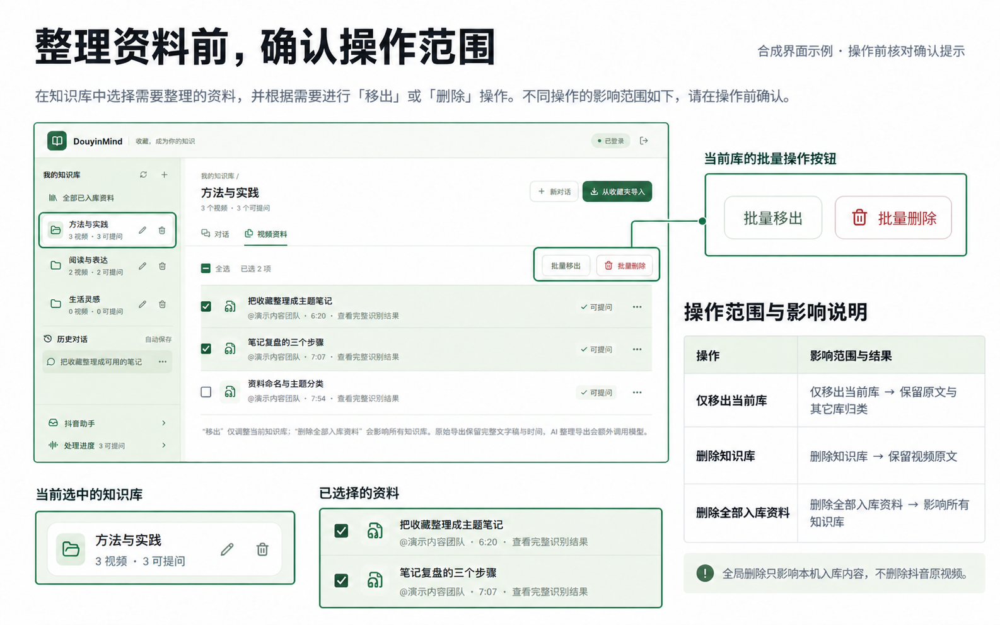
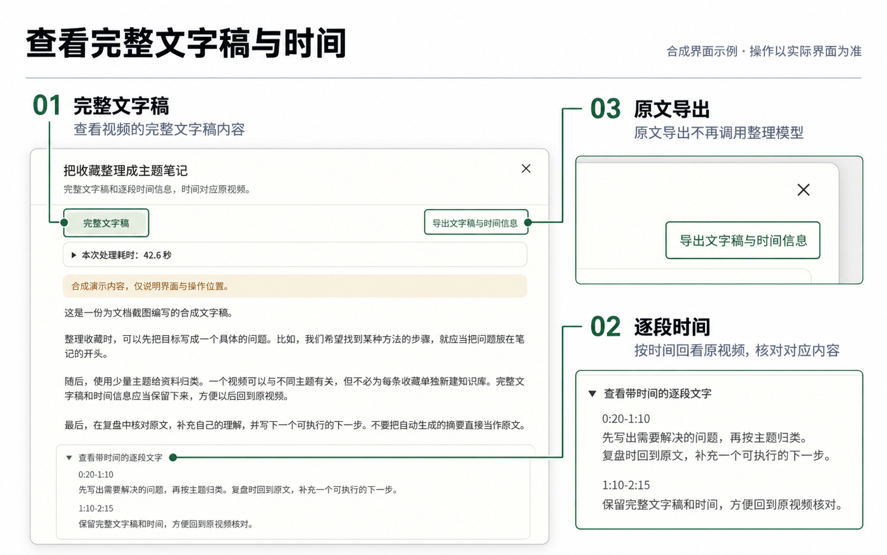

# 使用指南

[返回首页](../README.md) · [实验性抖音助手](抖音助手使用说明.md)

## 两种使用方式

| 入口 | 适合做什么 | 资料范围 |
| --- | --- | --- |
| 网页知识库 | 收藏整理、较完整的问答、原文回看与导出 | 当前选择的知识库或全部已入库资料；历史对话保留原范围 |
| 实验性抖音助手 | 在评论区用自然话请求保存当前视频、提问或承接已核对线程的普通追问 | 未指库提问使用本人本机全部入库资料；保存需明确目标库或先询问 |

助手首次配置尚需维护者准备，不是完成收藏登录就自动拥有B会话。下面先介绍普通知识库；助手的账号、核验和恢复步骤见[独立说明](抖音助手使用说明.md)。

本文配图基于合成界面制作，按钮以实际界面为准；不含真实账号资料，也不代表实际任务或送达证明。

[搜索并导入](#连接收藏与导入视频) · [批量整理与删除](#知识库范围与删除) · [提问与来源](#提问追问与依据) · [回看和导出](#原文复制与导出) · [遇到中断](#恢复时先区分是哪类任务)

## 连接收藏与导入视频

1. 点击首页「扫码登录 · 开始构建」。项目会打开收藏浏览器，由本人扫码登录；完成后读取收藏夹。
2. 在「我的知识库」新建主题，或在导入确认窗口中新建。
3. 点击「从收藏夹导入」，在左侧选择收藏夹。视频较多时，在「搜索视频标题」输入标题关键词，再勾选需要的视频。
4. 核对底部「已选」数量，点击「导入所选视频」，在确认窗口检查目标知识库、视频数量与费用提醒，再点「确认导入」。
5. 在「处理进度」等待资料完成，再查看文字稿或提问。同步到列表只是取得收藏信息，不代表已完成声音识别和索引。

*先选择视频，再确认目标知识库、数量与费用提醒；跨收藏夹切换会保留已选项。*

### 搜索、全选与整夹导入有什么区别？

- **搜索视频标题**：筛选当前展开收藏夹已加载的视频标题；不搜索作者或文字稿。切换收藏夹后，可在对应列表继续查找。
- **全选搜索结果**：只勾选当前匹配且可选择的视频，不代表选中了收藏夹全部内容。
- **跨收藏夹选择**：切换收藏夹会保留已选视频；搜索没有显示的已选项也不会自动取消。导入前看底部总数；需要重新选择时点「清空」。
- **整夹导入**：仍按整个收藏夹准备导入，**不受标题筛选影响**。「导入全部收藏」的范围更大，确认前务必再看视频列表与数量。

完整选择同一个收藏夹、使用整夹导入或导入全部收藏时，默认按收藏夹名称创建或复用知识库；部分或跨夹混选可手动指定目标库。

一个视频可属于多个知识库。完成的资料再次归类时可复用，不重新识别；失败重试仍可能发生识别调用。未登录时的「先体验 AI 对话」只使用配置的回答服务，不读取收藏。

## 知识库范围与删除

选中知识库后，资料列表、总结和新对话使用该库已完成的视频。切换库会开始新对话；重新打开历史对话时恢复其原范围。浏览收藏夹不会悄悄改变正在聊天的范围。

「全部已入库资料」是所有已保存资料的入口，包括没有归入某个知识库的已完成视频。取消抖音收藏或重新同步不会清空已有入库资料。

*先看当前库名，再选择移出或全局删除；删除知识库会保留视频原文。*

### 批量整理视频资料

1. 在左侧选中一个知识库，再打开顶部「视频资料」。选择「全部已入库资料」也能查看全局资料。
2. 勾选已完成、标为「可提问」的视频，或用列表上方「全选」。处理中或失败的视频不能作为批量删除项。
3. 只想调整归类时，在具体知识库中点「批量移出」；确实要清除这些视频的本机入库内容时，点「批量删除」。
4. 核对确认框中的范围与数量。完成后看反馈数量；发生失败或结果未确认时，先刷新核对。

| 入口 | 影响 | 仍会保留 |
| --- | --- | --- |
| 视频「更多 → 仅移出当前知识库」或「批量移出」 | 移除所选视频与当前库的归类关系；仅在选中具体库时可用 | 文字稿、检索资料和其它库归类 |
| 视频「更多 → 删除全部入库资料」或「批量删除」 | 删除所选视频的全局文字稿与检索资料，并从所有知识库移除 | 抖音收藏夹中的原视频；需要时可重新选择入库 |
| 「我的知识库」中对应库的垃圾桶按钮 | 删除这个知识库及其成员关系 | 视频原文和其它库归类；保留的视频仍可从「全部已入库资料」查看 |

批量操作逐个提交，遇到第一个失败或不确定结果就停止后续项；**已经成功的项不会全部回滚**。页面会显示已完成数量，并保留未确认项的勾选。不要看到失败就重新提交整批。

### 删除一个知识库

在「我的知识库」找到对应库的垃圾桶按钮，确认名称和「视频原文会保留」后再删除。删除当前选中的库后，页面回到全部资料并开始新的对话状态；删除其它库不会重置当前对话。与已删除库关联的历史不会自动改成全部资料问答；入口不可用时，应另选现有资料范围开始新对话。

回答生成期间暂不可切换知识库；批量操作或删库期间，也会暂时锁定相关输入与范围切换。导入或视频处理期间，批量资料操作暂不可用。后台仍有资料处理或排队时，删除知识库可能被拒绝，应等待任务结束。体验模式不提供这些收藏资料管理操作；其它不可用情况以页面提示为准。

删除和重试前先确认当前没有相关处理任务。不要用清空资料来解决助手回执不明。

## 提问、追问与依据

网页回答逐步显示，完成后显示实际引用来源。展开过程可查看已记录耗时、本次给模型的原文片段与字符数。检索片段只是本轮提供的资料，不等于完整文字稿，也不代表每一段都被答案引用。

*发送前看资料范围，回答后核对引用；可在同一对话继续追问。Enter 发送，Shift + Enter 换行。*

每条网页问题去掉首尾空白后最多2000个字符，以输入框计数为准；过长会保留输入并提示修改，不截掉后半句。可以继续问步骤、原因或数字；对象含糊时，直接写出视频或主题名称更可靠。

资料没有给出某个数字、期限或授权时，应说明缺少依据。有来源也不保证结论完全正确，应核对原文是否支持这句话。识别稿有误时，答案可能沿用错误，需要回听原视频。

实验助手公开回复不追加来源编号尾巴，内部仍留实际依据；用户明确要求原文时，仍须提供可对应的摘录。网页问答的来源显示与复制功能不因此取消。助手正文受评论长度限制，较完整的说明宜回到网页查看。

## 原文、复制与导出

「视频资料」中可查看完整文字稿、逐段时间、识别警告、已有画面分析与处理耗时。默认 `audio`（只分析声音）不会新生成画面结果，旧结果仍可查看和导出。

*点击视频资料标题回看完整文字稿，结合逐段时间核对，并按需导出原文。*

视频「更多」菜单提供：

- **导出原文与时间**：保留识别文字及时间，不再调用整理模型。
- **AI整理导出**：使用回答服务整理成笔记，会额外产生模型用量，整理稿不能替代原文证据。

网页回答的「复制」会带上已引用的视频来源。历史对话可打开、继续、重命名和删除；删除会清除该段对话的消息，先有确认。生成期间暂时不能切换或删除当前对话。

## 处理进度、时间与费用

左侧「处理进度」展示下载、转写、保存状态、失败原因及允许的恢复入口。助手的「任务队列」还记录指令、权限、选库和回评；两者不是同一份任务清单。

没有可识别人声的视频可能无法产生文字稿。音乐、静音或长停顿不能被强行补成内容。声音识别采用分段处理，成功片段可按兼容条件复用；全部完成后才标记视频成功。[声音识别说明](audio.md)列出并行、补听及缓存规则。

| 时间 | 应怎样理解 |
| --- | --- |
| 视频或音频时长 | 媒体本身多长，不是运行耗时 |
| 下载、识别、索引阶段 | 来自已记录的实际处理；旧资料缺失就显示未记录 |
| 本机助手处理 | 不含后续等待入库和发表；模型时间含理解指令与回答 |
| 关联视频处理记录 | 可能来自复用的旧资料，不等于本次重新下载或识别 |

问答、指令理解、声音识别、检索转换和整理导出可能分别收费。`tokens`（模型文字计量单位）不是人民币价格；助手面板只展示已记录的指令和回答用量，不覆盖所有服务。失败或未知调用不能按零计算。额度是请求前估算，不保证服务商账单绝不超出。

## 恢复时先区分是哪类任务

普通导入意外中断时，可在「处理进度」核对原视频与回执，再使用页面实际提供的重置/恢复入口；重置为待处理不自动重新导入。已处理片段可能复用，但后续请求仍可能计费。导入进行中不要重置或另起第二个后台。

助手任务保留原评论、已发生费用和发送记录。刷新仅重新读取；「核查任务状态」是显式核对；「继续未开始任务」和「重试本次问答（仅一次）」有不同条件。只有按钮实际可用才按相应说明操作，不能删除台账来恢复。

回复结果不明时，不重发、不重导视频，也不自行删评后再试。已入库成功与公开回执送达分开记录；B回读可见也不能替代提问者视角。详见[助手状态与安全恢复](抖音助手使用说明.md#查看任务与安全恢复)。

## 常见问题

### 为什么没有给出另一个库的答案？

网页当前库就是本轮资料范围。需要其它资料时切换到相应库或全部资料，再开始新对话。助手未指定库的提问使用本人本机全部入库资料；明确指定库时严格限制在该库，未知或歧义库名不偷偷回退到全部。

### 为什么查找过程写着关键词后备？

问题的Embedding（检索转换）服务遇到明确临时超时、连接、限流或服务端故障时，可改用当前范围的关键词查找；它不等同正常语义检索，换一种说法的资料可能漏掉。密钥、权限和本地索引错误不会伪装成正常完成。

### 为什么助手显示可见，我却没看到？

先核对是否为同一账号、视频、原评论和回复线程，并在允许时正常展开。助手状态仅说明B侧回读，不自动证明A侧可见；仍未核清时保留两种观察，不能猜测平台原因或自动删重发。“此评论不支持分享”本身不足以确定风控或半隐藏。

### 体验模式和B登录是一回事吗？

不是。网页体验模式不登录抖音；收藏登录使用收藏会话；实验助手使用独立B后台会话。A/B授权和公开回复也需单独确认，不会互相继承。

### 网站打不开或更新不生效怎么办？

使用根目录正常启动脚本，核对网页和后台地址。启动器本地日志位于 `backend/app/storage/local_services/`；只提供脱敏错误码，不公开完整私人日志。代码更新需要相应进程正常重载，不能只看网页刷新；先停止助手并等待已受理工作结束，不强杀处理中的服务。

[返回首页](../README.md) · [助手详细说明](抖音助手使用说明.md)
