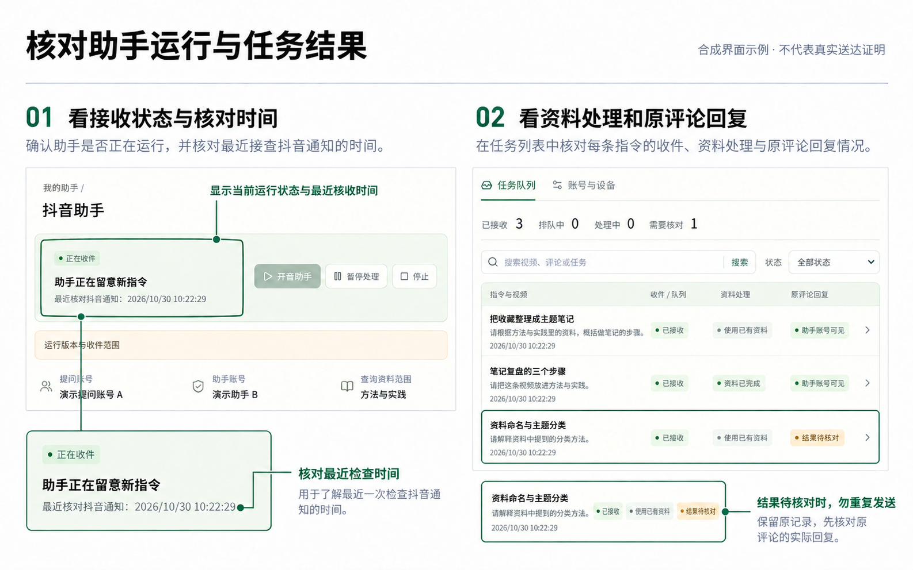

# 抖音助手使用说明

[返回首页](../README.md) · [收藏知识库使用指南](usage.md)

## 定位与当前边界

这是 DouyinMind 的**本机实验性助手**：经过本机配置和明确授权后，注册的提问账号A可在抖音评论中真正 @ 助手账号B，请它保存当前视频或根据本人已入库资料回答。

模型负责理解自然话与选择受限工具；程序负责核对账号、设备、知识库权限、原评论、处理回执及一次发表。模型不能用一句“已授权”增加权限，也不能替换账号、视频或资料路径。

目前收藏知识库可独立安装使用；完整评论助手的首次准备仍需维护者，尚无面向全新安装的一键初始化向导。真实跨电脑通道尚未接通，不能把本机多账号登记宣传成多人云服务。

本文配图基于合成界面制作，按钮以实际界面为准；不含真实账号资料，也不代表实际任务或送达证明。

## 首次配置与日常入口

### 先区分三种状态

- **收藏登录**：首页扫码流程打开收藏浏览器，用于读取自己的收藏与下载资料。
- **助手B登录**：独立的产品后台会话；收藏账号已登录不代表B已登录。不能把收藏浏览器、手机或其它工具里的会话直接当成当前B会话。
- **本机授权**：在「账号与设备」明确选择允许查询、保存及公开回复的范围。它不是抖音官方认证，也不替代实际登录。

安装依赖、声音识别密钥和Windows启动方法见[快速开始](../README.md#快速开始windows)。主项目运行后，左侧「抖音助手」是日常入口。

### 全新安装尚需维护者准备

当前源码要求以下本机状态；这里只说明用途，不提供真实账号、登录内容或可套用的他人配置：

| 通用相对位置 | 作用与限制 |
| --- | --- |
| `backend/app/storage/mention_receiver/receiver.local.json` | 接收器配置：固定B的 `receiver_public_number`（公开抖音号）与 `receiver_profile_url`（规范公开主页）；日常启动先读取它 |
| `backend/app/storage/assistant/registry.sqlite3` | Registry（本机授权登记台账）；可经网页显式新建用户、设备与库授权，不必先建立旧绑定 |
| `backend/app/storage/assistant/native-receiver.json` | 原生收件配置：固定B的UID（平台内部账号标识）、sec UID（公开主页标识）及主页必须一致；公开抖音号不能冒充UID |
| `backend/app/storage/assistant/native-receiver/` | 原生通知归属台账与程序自有加密会话；当前完整链路要求由维护者正确初始化，未提供完整公开初始化工具 |
| `backend/app/storage/assistant/semantic-intent.json` | 显式语义理解开关；默认关闭。启用后还会准备持久理解记录，不是只填写模型密钥就自动启用 |

原生配置缺失时，代码还保留正常网页收件路径，但不等同当前已配置环境的完整原生收件、API先理解与本人核验闭环。本人核验的最终身份核对也依赖已经准备好的原生B会话能力。因此，新用户不能靠打开核验页补齐上述所有初始化。

不要把已有数据库删除成“首次设置”，不要创建零字节台账，不复制他人的登录资料或保护标记。配置与台账不一致时应保留现场，由维护者核对。

如果已有旧版 `local-binding.json`（原A/B与单库绑定），可在网页明确选择「登记原有本机绑定（如果已有）」；这是可选迁移，不是全新安装的必经步骤。旧 `app.mention_agent bind` 命令不是完整助手初始化向导；日常授权建立后，旧执行入口会被阻止，不能删除Registry来重新启用。

### 在网页确认账号、设备与范围

1. 打开「抖音助手 → 账号与设备」，本人勾选确认后进入本机管理。
2. 添加A/B公开主页或核对已有记录，确认本人账号；登记并确认当前本机设备。
3. 按需要分别允许：本人全部资料查询、目录名称读取、公开回复及逐库保存。
4. 有明确保存权限的库才可作为目标；目录能看到一个库不等于能向它写入。

管理会话仅保存在页面内存中，有效15分钟，过期后重新确认。它是本机操作者声明，不是平台账号所有权证明。新账号、新设备不会继承旧权限。

「一并授权当前知识库」只对当时目录中已有库生效，不自动覆盖未来新建库；公开回复仍是单独许可。没有公开许可时，允许的处理结果可留在本机，不会因后来打开公开许可就发表旧结果。

## 开启、暂停与停止

| 按钮 | 真实作用 |
| --- | --- |
| 开启助手 | 请求启动或继续本机B后台会话；以实际就绪状态为准 |
| 暂停处理 | 停止领取新任务与新发表；正常情况下新指令仍可登记排队 |
| 停止 | 停止收件与后续新处理，保留原任务及会话资料 |

B使用 `headless`（后台无桌面窗口）模式，不会遇到核验就自动弹出桌面窗口。保持电脑、主后台与助手进程可用；网页不必一直位于前台。关闭主服务、电脑休眠或断网会影响收件。

暂停不是撤销权限：已领取的任务可能处理到当前任务结束，原后台已受理的入库也可能继续。停止不能撤回已经发出的模型请求、导入或评论。更新代码应先正常停止助手、等待相关工作结束，再加载相应服务的新版本。

也可使用根目录「启动抖音助手.bat」，或在 `backend` 目录运行 `uv run python -m app.assistant` 登记相同的启动请求；这不会跳过配置与权限检查，不是另一个无门禁执行入口。

首次启用会建立已有通知基线，不自动把历史通知全部当新请求。之后按轮次收件与有界页面核对；通知延迟、读取失败和页面范围都可能漏件，不能承诺每条评论都收齐。轮数不是任务数，网页刷新成功也不代表B刚核对过通知。

*查看运行状态与最近核对时间，再核对任务记录；账号与权限在「账号与设备」中单独管理。*

## 用自然话保存和提问

在视频评论输入区，从平台的 @ 列表选中真实B，再写需求。只手打“@昵称”不一定产生真正提及。以下库名仅为示例，需换成本人实际获准的目录名称。

| 想做什么 | 自然话示例 | 程序应做什么 |
| --- | --- | --- |
| 保存但没选库 | “帮我把这条视频收进知识库吧” | 原线程询问本人可用目录和数量；等待选择，不先导入 |
| 指定库保存 | “能不能存到学习笔记里？” | 理解目标后重新核对唯一库、当前视频及保存许可 |
| 无库提问 | “根据我存的资料解释一下这个概念” | 查询本人本机全部入库资料，不只查默认库 |
| 指定库提问 | “根据学习笔记里的资料，说明这个方法的步骤” | 只查指定库；未知或歧义目标不回退到全部 |

语义模式理解口语、简称与礼貌疑问句，不要求固定短语或编号；简称只有唯一明确对应时才可采用。不明确、否定、条件或转述不能变成无条件保存。模型不是任意中文都能可靠理解，意思或库名有歧义时应澄清。

### 没写保存位置时

B会在原线程列出本人当前获准目录和数量。用同一A在这条问句下普通回复即可，例如“收进学习笔记就好”；不必添加测试编号或再次 @。数量来自当前目录，不在说明中固定为某个数。

普通选库回复必须与原Root（最初请求）、B询问和当前A选择可靠对应，且仍有当前权限。选择成功后另建保存子任务，可在详情点「查看对应保存任务」。问过库、选过库都不代表视频已完成入库。

目前一次选库或保存只处理一个动作，**尚未实现保存完成后自动继续总结的复合流程**。需要后续问答时，先等待资料完成，再在可靠对应的原线程中单独提出问题；不能把一条保存回执当成总结也已完成。

没有写库名就应询问，不因设置过默认库或上次使用过其它库而替用户决定。新的真正 @ 指令按本次独立请求理解，不能用“第四个”等无可靠旧线程背景的文字套用当前目录顺序。

### 查询范围与公开依据

未指定库的提问使用本人本机「全部入库资料」：全部处理完成且可检索的视频，包括未归入某个知识库的资料。这个范围需明确授权，不是若干库的拼接，也不会继承给其它用户或电脑。

明确指定库时仅查该库；未知库、多个可能目标或权限撤销时澄清或停止，不偷偷扩大范围。以前的对话只帮助解指代，不把检索范围退回旧库，不把旧答案直接当证据。

只问“这里主要讲什么”，可聚焦原评论所在视频；问“这条视频的观点和以前收藏的资料有什么联系”，可在本轮已经授权的范围内关联检索。明确指定了某个库，关联检索也仍限于该库，不会变成查询所有库或其他人的资料。模型选择仍可能出错，需结合实际原文判断。

公开回复采用自然正文，不追加“来源：资料N”等尾巴。内部记录实际检索来源、原文片段标识、逐字核对信息及已记录的视频时间；查看依据时仍应回到对应原文。逐字核对不能证明所有改写的语义都准确。明确要求两条原文依据时，正文也需包含可对照的真实摘录；两条可以来自同一可靠来源，不强制凑成两个视频。正文有长度限制，复杂问题适合在网页展开。

## 原线程普通追问

已保存并有B回执的线程中，可直接回复B继续问，不必再次 @。程序会重新核对同A/B、视频、原Root、B旧回执和当前回复，再将这条普通回复作为新的只读问答，不借此导入视频。

程序已为严格核对过的普通追问加入查询语境：省略对象时可默认承接当前视频，允许的动作只有查询或澄清；这不能授予保存、取消旧任务或操作其它视频的权限。明确指定了资料范围时，仍遵守本轮已有授权。

**短句承接仍属实验能力，尚不能承诺任意短问或多层指代均能正确理解。** 初次使用宜说清希望了解的内容；收到澄清时可补充对象或问题，不应反复恢复已有收费任务。源码与合成检查不能替代新增真实场景的完整验收，也不会自动改判或重发已有回复。

同一最初请求下的多条派生回执会按已保存的任务关系归并，不再只因回执数量增加就判为歧义；每轮仍须重新核对实际页面。不同起始请求、父链不明确或多个候选仍暂停，不会挑第一条、最新或相似回执替代。只确认同一原线程，并不等于证明了具体哪条B回复是直接父评论。独立顶层评论不自动成为同一段追问。

网页「视频资料」中的删除或移出只管理本机资料，不会撤回已发出的抖音评论。删除知识库后，该库不再是可用的查询或保存目标；历史授权不会替用户扩大范围或重新建库。需要调整归类时，先看[资料管理的三种范围](usage.md#知识库范围与删除)。

## 本人登录与核验

只有当前产品显示可用的「本人登录/核验」入口时，才打开该入口。本机地址为 `http://127.0.0.1:8767/`，连接同一产品B会话，不换账号资料，也不提供桌面控制或开放调试端口。

1. 助手因登录/本人核验暂停且无在途工作后，点「开始本次核验」。
2. 在当前画面中由本人完成正常扫码或认证。需要输入或拖动时，由本人在核验页操作，不将密码、验证码发给聊天代理。
3. 点「我已完成，核对结果」。程序核对实际B身份；通过后仍保持暂停，回项目明确「开启助手」，再按原任务允许的路径核查。

已显示抖音主页只表示当前页面可见，完成检查仍须同时核对登记的B账号与原生身份接口。已登录主页没有可输入的认证区域时，「当前核验区域未识别」表示仅可查看画面和核对结果，不代表账号错误。身份接口返回业务错误也不等于验证码输错；此时保留暂停，不能仅凭主页可见判定通过或反复提交验证码。

若提示「通知数据格式未通过本机校验」，说明通知编号等数据需要程序核对。主页核验不能替代这项检查；助手保持暂停，保留原任务与通知游标，不跳过异常通知，也不要求本人重复输入验证码。

通知编号校验失败时，本机台账只记录字段类别、值类型和错误类别三个固定诊断项，不记录异常原值、账号或评论编号、正文或完整链接。这些诊断不授予执行权限，也不能作为跳过通知或解除暂停的依据。

部分回复通知的内层视频编号是空字符串时，程序仅采用同一条通知中通过校验的外层明确视频编号；其他已提供的编号仍须一致。缺失、异常或冲突的编号继续拒绝，不据此推断原评论的父子关系，执行前仍须核对原评论页面和现有授权。

单次人工模式有有效期，当前默认最多5分钟。画面只在内存中转发，不落盘；输入不记入日志。无法可靠识别唯一认证区域时只允许看画面，不允许向普通评论区输入；不能自动解验证码。

入口缺失、被占用、身份未核清或提示仅可查看时，保持暂停，不假定核验已完成。不应自行打开另一profile（浏览器账号资料目录）替代当前B。数据格式、本地会话临期或页面读取错误不等于短信验证，不能只因黄色提示就要求用户输入验证码。

### 接口等待与接收故障

「接口暂时等待」表示收件接口正在有界等待，部分临时失败会按45秒、90秒的间隔再核对；等待期间可能仍显示运行中。它与达到重试上限后的持续暂停不同，不表示正在重新发表旧回复，也无需因此重新发送评论或输入验证码。「收件暂时受阻」表示通知或页面读取需要核对，不能直接认定是验证码、账号风控或评论被隐藏。

`native_api_error`（接口返回了未识别的非成功业务状态）与真实登录或核验异常分别记录。维护者可核对当前失败的固定接口角色、HTTP（网络响应）数字状态和业务数字码；不保存完整请求地址、响应原文或登录内容，也不能用新诊断补出旧故障当时没有记录的数字。诊断只用于排查，不是权限或送达证明。

对于程序已识别、允许显式重新核验的身份接口错误，确认当前进程和账号正确、没有在途工作或人工核验会话后，可按页面实际提供的「开启助手」重新核对一次。程序仍须检查空草稿、同一B浏览器会话、固定UID与当前身份；不能仅凭主页可见放行，未知或其它类型的错误也不会一概解除。

通过后会恢复正常调度，可能继续处理新的授权请求；这不是把旧任务、已发生费用或发送记录清零。若仍失败，保留暂停与原记录，交维护者排查，不循环开启或重启。代码更新等确需重载时，再正常停止、等待结束并加载匹配版本。真正的验证码仍由本人完成，不因重新开启而绕过。

## 查看任务与安全恢复

任务队列保留收件、资料处理、原评论回复三个阶段。详情先显示问题、结果、保存位置与下一步；来源、步骤、耗时、用量在可展开的「处理记录」。异常及可用恢复按钮不会因折叠记录而隐藏。

日常查看可按这个顺序：在「任务队列」搜索视频、评论或任务，按状态筛选；打开对应行，先核对原评论与资料范围；再看回复状态、可用操作和「处理记录」。搜索或刷新只读取已有记录，不会重新执行指令。

| 状态或入口 | 含义与可做事项 |
| --- | --- |
| 等待选库 | 等待本人选择，尚未开始保存 |
| 排队、处理中、资料已完成 | 分别是受理、处理过程和完成；不代表公开回复已送达 |
| 已处理，未公开回复 | 结果仅在本机；以后改变许可也不会自动发表旧结果 |
| 助手账号可见 | B侧回读到精确回复，A或他人可见性需另核对 |
| 结果待核对 / `delivery_unknown`（发送结果未知） | 保留原发送记录，不自动重发 |
| 刷新记录 | 重新读取本地详情，不是重新执行任务 |
| 核查任务状态 | 显式核对原记录；适用时可只读回查已有回复，请求处理完不代表资料或评论完成 |
| 继续未开始任务 | 只有后台确认未开始且无不明副作用时才出现，不是通用重试 |
| 重试本次问答（仅一次） | 只适用受限的无答案、无入库/发送副作用的查库失败；会重新调用模型并累计费用 |

旧的入库成功记录会保留，但当前回执读取失败时，工具不会冒称刚刚重新核对成功。只有标题、作者等元数据也不算可提问正文；资料是否完成与公开回复是否送达仍分别核对。

首次模型请求因额度拒绝、确实从未开始的任务，调高额度后仍可能需要等原处理租约结束，再核查并显式继续。已有付费轮次、未知用量、发送预约或旧失败不因此清零。

高级只读诊断仍有CLI（命令行入口），不都是图形按钮。在 `backend` 目录用 `uv run python -m app.assistant --help` 查看实际参数：

| 参数 | 范围 |
| --- | --- |
| `--inspect-assistant-reply` | 填32位任务号；在当前暂停且闲置的B owner（会话所属进程）下，只读重开原线程检查已有回复，不再次发送或提升旧送达状态 |
| `--inspect-thread-followup` | 对符合条件的完整 `native:…` 来源号，只读核对追问线程，不调用模型或建任务 |
| `--inspect-native-visibility-hint` | 对符合条件的 `native-hint:…` 提示，只读检查原网页定位 |

这些入口要求当前运行、暂停、闲置、无人工模式冲突、固定B身份和当前权限；登记请求不等于检查通过。其它review/recover（显式恢复审查）参数只适用被严格限定的未执行来源，可能允许随后重新读取，不是无条件重试。普通用户不应为“试一下”反复调用；无可用恢复入口时保留记录交维护者核对。

不要手改数据库状态、删除发送屏障、重置attempts（已尝试次数）、清除未知费用或删掉SQLite（本地数据库）的恢复日志。升级和重新开启不会把旧的未知发送重新发表。

## 费用、时间与数据

- **费用**：指令理解和最终处理可能各有模型响应；多份响应不等于多条公开评论。面板已记录的 `tokens`（模型文字计量单位）不含所有声音/向量服务，不代表人民币账单，缺失不填零。
- **额度**：单任务和当日限制用于请求前准入估算。未知调用继续占用预留，不自动释放；修改额度不消除旧费用。
- **耗时**：本机处理不含后续等待入库和发表；模型包含理解与回答。视频阶段来自关联处理记录，缓存复用不算本次重做；媒体时长不是处理耗时。
- **云服务**：入库音频、问题及检索片段会发给配置的服务。资料在本机不等于完全离线。
- **保护**：账号、设备或库权限可撤销，历史保留。新账号、远端设备及未来新库不会自动继承权限。损坏/缺失的授权台账不能通过删文件回退成旧绑定。

## 送达与已知限制

B回读可见只证明B视角。有些回执可以在提问账号看到，有些仍只被B看见；不得用一次成功覆盖另一条未知。

如果A暂时没看到，先核对账号、视频、原评论和展开范围，保留A/B各自事实。用户看到“此评论不支持分享”只证明当前分享动作不支持；尚未找到可将它等同“风控半隐藏”的官方依据，具体原因未确诊，不能据此删评重发。

平台通知可能延迟，原评论可能无法在有界查找内定位；不保证所有第三方视频、所有评论和所有历史提醒均可处理。长视频也不保证在某个固定分钟内完成。一个页面超时不是整条流水线必然停止，已有后台入库应查询原记录。

目前是本机使用和实验验证，不是高并发生产服务或长期无人值守承诺。多账号权限登记、隔离测试、空闲观察均不能替代真实跨电脑或全面送达验收。

## 历史 / 开发参考

早期版本依次验证过预览收件、限定单任务、一次发表、全资料查询、询问目标库、只读回执与普通追问。旧版所用固定标记、独立可见测试窗口和阶段性计数，不再作为当前日常操作要求。

包含真实账号、视频、任务和截图的历史全文及失败证据保留在维护者本机，未作为公开使用材料，也不在这里链接。本文只陈述当前入口与有限验证范围；没有把旧测试总数、旧版本空闲观察或个别成功写成当前所有功能通过。

公开开发参考：[历史接收器原型](mention-receiver-prototype.md) · [跨电脑设计草案](抖音助手跨电脑实施方案.md) · [源码结构](architecture.md)
